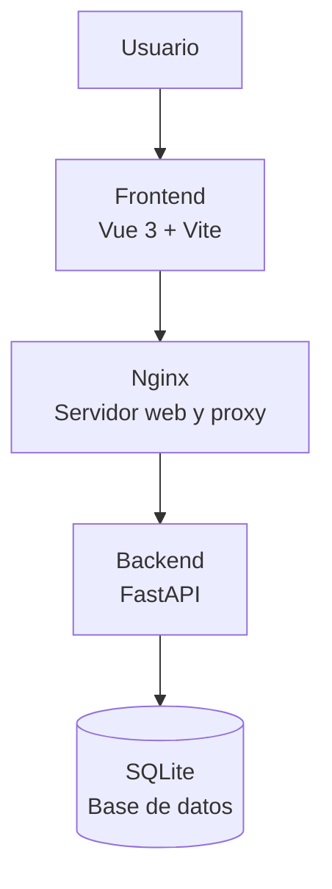

# SISTEMA DE CONTRATACIONES

### Plataforma de gestión y seguimiento de procesos de contratación

**Sistema web para administrar vacantes, candidatos y procesos de selección desde una plataforma centralizada.**

---

<p align="center">

**TECNOLOGÍA · ADMINISTRACIÓN · CONTROL · TRANSPARENCIA**

</p>

<p align="center">


</p>

---

## 1. Descripción general

El **Sistema de Contrataciones** es una aplicación web diseñada para facilitar la administración, organización y seguimiento de los procesos de contratación.

La plataforma permite centralizar la información relacionada con vacantes, candidatos, usuarios y actividades administrativas, proporcionando herramientas para mejorar el control de los procesos y mantener un registro de las operaciones realizadas.

El sistema cuenta con una arquitectura cliente-servidor, mecanismos de autenticación, administración de permisos y herramientas de seguimiento que permiten gestionar las actividades de acuerdo con el perfil de cada usuario.

Su desarrollo está orientado a ofrecer una solución funcional, organizada y adaptable a las necesidades de gestión de personal.

## 2. Objetivos del proyecto

### Objetivo general

Desarrollar una plataforma web que permita administrar y dar seguimiento a los procesos de contratación mediante herramientas digitales que faciliten la organización de la información, el control de actividades y la gestión de usuarios.

### Objetivos específicos

- Centralizar la información de vacantes y candidatos.
- Facilitar la administración de los procesos de contratación.
- Implementar autenticación y control de acceso por roles.
- Mantener registros de las actividades realizadas dentro del sistema.
- Generar información estadística para apoyar el seguimiento de los procesos.
- Proporcionar herramientas de exportación y respaldo de información.
- Mantener una estructura tecnológica modular y de fácil mantenimiento.

## 3. Características principales

| Módulo | Descripción |
|---|---|
| Gestión de vacantes | Administración y seguimiento de oportunidades laborales. |
| Gestión de usuarios | Control de cuentas y permisos de acceso. |
| Autenticación | Acceso mediante mecanismos de validación de identidad. |
| Control por roles | Acceso diferenciado según el perfil del usuario. |
| Gestión de candidatos | Organización de información relacionada con los aspirantes. |
| Auditoría | Registro de actividades y operaciones del sistema. |
| Estadísticas | Consulta de información para el seguimiento de procesos. |
| Exportación | Generación de archivos CSV para el manejo de información. |
| Historial | Consulta del seguimiento de los procesos registrados. |
| Respaldos | Herramientas para respaldar la información almacenada. |

## 4. Arquitectura del sistema

La aplicación utiliza una arquitectura dividida en dos componentes principales: frontend y backend. Ambos se comunican mediante solicitudes HTTP a través de una API.

### Diagrama de arquitectura



### Componentes tecnológicos

| Componente | Tecnología | Función |
|---|---|---|
| Interfaz de usuario | Vue 3 | Construcción de la interfaz web. |
| Herramientas frontend | Vite | Desarrollo y compilación del frontend. |
| Servidor web | Nginx | Publicación de archivos y redirección de solicitudes. |
| API | FastAPI | Procesamiento de solicitudes y lógica del sistema. |
| Modelado de datos | SQLModel | Definición y administración de modelos. |
| Base de datos | SQLite | Almacenamiento de información. |
| Autenticación | JWT | Gestión de sesiones y autenticación mediante tokens. |
| Protección de contraseñas | bcrypt | Hash de contraseñas. |
| Pruebas | pytest | Ejecución de pruebas automatizadas. |
| Contenedores | Podman / Docker | Ejecución de los servicios de la aplicación. |
| Automatización | GitHub Actions | Integración y ejecución de flujos de trabajo. |

## 5. Perfiles de usuario

El sistema contempla diferentes perfiles para organizar el acceso a las funcionalidades.

| Perfil | Responsabilidad |
|---|---|
| Administrador | Administración general del sistema y gestión de usuarios. |
| Reclutador | Gestión y seguimiento de los procesos de contratación. |
| Auditor | Consulta y revisión de registros de actividad. |

Los permisos disponibles dependen de la configuración implementada para cada perfil.

## 6. Seguridad de la información

La seguridad es uno de los componentes considerados durante el desarrollo de la plataforma.

Entre los mecanismos implementados se encuentran:

- **Autenticación:** validación de usuarios mediante JWT.
- **Protección de contraseñas:** utilización de bcrypt para almacenar contraseñas mediante hash.
- **Control de acceso:** separación de permisos mediante roles.
- **Auditoría:** registro de actividades relevantes.
- **Protección HTTP:** configuración de encabezados de seguridad en Nginx.
- **Política de contenido:** configuración de Content Security Policy (CSP).
- **Persistencia:** almacenamiento de información mediante volúmenes de datos.

La configuración de seguridad debe mantenerse actualizada y revisarse antes de utilizar el sistema en un entorno productivo.

## 7. Estructura del proyecto

La organización general del repositorio es la siguiente:

```text
sistema-contrataciones/
│
├── backend/
│   ├── main.py
│   └── requirements.txt
│
├── frontend/
│   ├── src/
│   ├── public/
│   ├── package.json
│   └── Dockerfile
│
├── sistema-contrataciones/
│
├── docker-compose.yml
│
├── iniciar.sh
├── demo.sh
├── respaldo.sh
│
├── .env
├── .env.demo
│
└── README.md
```

> La estructura representa los componentes principales documentados del proyecto. Algunos archivos y directorios pueden variar conforme a la versión del repositorio.

## 8. Requisitos del sistema

Para ejecutar el proyecto se requiere un entorno compatible con las herramientas utilizadas.

| Requisito | Descripción |
|---|---|
| Sistema operativo | Linux o Windows. |
| Git | Para obtener y actualizar el repositorio. |
| Podman o Docker | Para ejecutar los servicios mediante contenedores. |
| Compose | Para administrar los servicios definidos en el archivo de composición. |
| Navegador web | Para acceder a la aplicación. |
| Conexión de red | Necesaria para descargar dependencias y obtener el repositorio. |

## 9. Instalación y ejecución

### 9.1. Obtener el repositorio

Clonar el proyecto desde GitHub:

```bash
git clone https://github.com/KevinAlva23/sistema-contrataciones.git
```

Entrar al directorio:

```bash
cd sistema-contrataciones
```

### 9.2. Ejecución en Linux

El proyecto incluye un script de inicio para facilitar la ejecución.

Dar permisos de ejecución:

```bash
chmod +x iniciar.sh
```

Ejecutar:

```bash
./iniciar.sh
```

Si se utiliza Podman Compose o Docker Compose directamente, y el entorno cuenta con el complemento correspondiente, también puede iniciarse mediante:

```bash
podman compose up -d --build
```

O:

```bash
docker compose up -d --build
```

### 9.3. Ejecución en Windows

En Windows se puede utilizar Docker Desktop con Docker Compose o una instalación compatible de Podman.

1. Instalar y configurar el motor de contenedores.
2. Abrir PowerShell.
3. Clonar el repositorio.
4. Acceder a la carpeta del proyecto.
5. Ejecutar el siguiente comando:

```powershell
docker compose up -d --build
```

También puede utilizarse Podman Compose si está instalado y configurado correctamente.

> El script `iniciar.sh` está diseñado para entornos Bash. Para Windows, se recomienda utilizar Compose directamente desde PowerShell.

### 9.4. Acceso a la aplicación

Una vez que los servicios estén iniciados, abrir el navegador y acceder a:

**Aplicación web:**

```text
http://localhost:8080
```

**Documentación de la API:**

```text
http://localhost:8080/api/docs
```

La disponibilidad de estas direcciones depende de que los contenedores hayan iniciado correctamente y de que el puerto esté libre.

## 10. Configuración del entorno

El proyecto contempla archivos de configuración para establecer los parámetros necesarios de ejecución.

| Archivo | Propósito |
|---|---|
| `.env` | Variables de entorno de la aplicación. |
| `.env.demo` | Configuración destinada al entorno de demostración. |

Las variables de entorno pueden incluir parámetros de ejecución, autenticación y configuración interna.

**Recomendaciones:**

- No publicar contraseñas ni claves privadas.
- No compartir tokens de autenticación.
- No subir archivos `.env` con información sensible.
- Mantener una configuración independiente para pruebas y producción.
- Utilizar valores seguros para las claves de autenticación.

## 11. API y documentación

El backend utiliza FastAPI para proporcionar los servicios de comunicación entre la interfaz y la lógica de negocio.

La documentación interactiva permite consultar los endpoints disponibles y revisar los esquemas de las solicitudes y respuestas.

**Documentación:**

```text
http://localhost:8080/api/docs
```

Desde esta sección es posible consultar los servicios disponibles según la configuración actual de la API.

## 12. Almacenamiento y persistencia

La aplicación utiliza SQLite como sistema de almacenamiento documentado para la configuración actual del proyecto.

La persistencia de la información se gestiona mediante un volumen de datos, lo que permite conservar los registros independientemente del ciclo de vida de los contenedores.

La estructura de almacenamiento debe mantenerse protegida y respaldarse periódicamente para reducir el riesgo de pérdida de información.

## 13. Respaldos de información

El proyecto incorpora un script destinado a facilitar la generación de respaldos.

En Linux, ejecutar:

```bash
./respaldo.sh
```

Los respaldos deben almacenarse en una ubicación segura y mantenerse separados de los archivos públicos del repositorio.

Se recomienda:

- Realizar respaldos periódicos.
- Verificar que los archivos generados sean accesibles.
- Mantener copias independientes del entorno de ejecución.
- Probar periódicamente los procedimientos de recuperación.

## 14. Entorno de demostración

El proyecto contempla un entorno de demostración para facilitar la revisión de sus funcionalidades.

Este entorno permite evaluar el comportamiento general de la plataforma sin utilizar información real de procesos de contratación.

Se recomienda utilizar exclusivamente datos ficticios durante las pruebas y demostraciones.

## 15. Publicación y acceso remoto

La aplicación puede utilizarse localmente o configurarse para permitir el acceso remoto mediante servicios de publicación compatibles.

En el entorno documentado se contempla el uso de **Cloudflare Tunnel** para establecer una conexión entre la aplicación local y una dirección pública.

Esta alternativa permite publicar el servicio sin necesidad de configurar directamente una IP pública en el equipo.

La publicación remota requiere una configuración adecuada del dominio, túnel, servicios y políticas de seguridad.

> Antes de habilitar el acceso público, se deben revisar las credenciales, permisos, configuración de autenticación y exposición de los servicios.

## 16. Pruebas y control de calidad

El proyecto contempla el uso de herramientas de pruebas automatizadas para revisar el funcionamiento del backend.

La herramienta utilizada es:

**pytest**

Ejecución de pruebas desde el entorno del backend:

```bash
pytest
```

También se contempla el uso de GitHub Actions para automatizar procesos de integración y validación del proyecto.

## 17. Mantenimiento y actualización

Para mantener el sistema en condiciones adecuadas de funcionamiento se recomienda:

1. Revisar periódicamente las dependencias.
2. Mantener actualizado el repositorio.
3. Verificar los registros de ejecución.
4. Comprobar la disponibilidad de los servicios.
5. Realizar respaldos de la información.
6. Revisar los permisos de acceso.
7. Ejecutar las pruebas después de realizar cambios.
8. Documentar las modificaciones realizadas.

## 18. Historial de versiones

El proyecto ha evolucionado mediante distintas actualizaciones enfocadas en ampliar sus funcionalidades, mejorar su estructura y fortalecer su administración.

| Versión | Descripción |
|---|---|
| v1.0 | Implementación inicial del sistema. |
| v1.1 | Mejoras en la estructura general. |
| v1.2 | Ajustes en funcionalidades y administración. |
| v1.3 | Mejoras en la interfaz y experiencia de usuario. |
| v1.4 | Actualizaciones en los procesos internos. |
| v1.5 | Mejoras en la gestión de información. |
| v1.6 | Ajustes de funcionamiento. |
| v1.7 | Mejoras en la administración de usuarios. |
| v1.8 | Actualizaciones en la gestión de vacantes. |
| v1.9 | Mejoras en los procesos de seguimiento. |
| v1.10 | Ajustes generales de funcionamiento. |
| v1.11 | Mejoras en la organización de la plataforma. |
| v1.12 | Actualizaciones en la interfaz. |
| v1.13 | Mejoras en los procesos administrativos. |
| v1.14 | Ajustes de seguridad y funcionamiento. |
| v1.15 | Mejoras en el control de información. |
| v1.16 | Actualizaciones en funcionalidades internas. |
| v1.17 | Mejoras en la administración del sistema. |
| v1.18 | Ajustes de rendimiento y estabilidad. |
| v1.19 | Mejoras en los procesos de gestión. |
| v1.20 | Actualizaciones generales. |
| v1.21 | Mejoras en la organización de los componentes. |
| v1.22 | Ajustes en los procesos de administración. |
| v1.23 | Incorporación de trabajos relacionados con PostgreSQL, Alembic y herramientas de respaldo de bases de datos. |
| v1.24 | Mejoras en la gestión y funcionamiento general. |
| v1.25 | Ajustes en la organización y administración. |
| v1.26 | Mejoras en funcionalidades y estabilidad. |
| v1.27 | Actualización de componentes y mejoras generales del sistema. |

## 19. Consideraciones importantes

- El sistema debe ejecutarse en un entorno compatible con sus dependencias.
- La información de acceso debe mantenerse protegida.
- Los archivos de configuración con credenciales no deben publicarse.
- Los respaldos deben almacenarse de manera independiente.
- La configuración de publicación remota debe revisarse antes de habilitar el acceso público.
- Se recomienda realizar pruebas antes de implementar nuevas versiones.
- La información utilizada durante las demostraciones debe ser ficticia.

## 20. Autor y repositorio

**Proyecto:** Sistema de Contrataciones

**Desarrollador:** Kevin Alvarado Garduño

<p align="center">

**SISTEMA DE CONTRATACIONES**

*Gestión organizada, procesos eficientes y control de información.*

</p>
