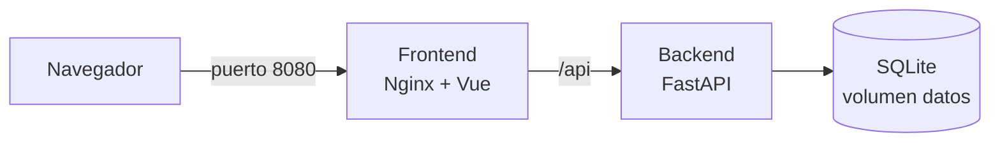

# Sistema de Contrataciones

Aplicación web para gestionar candidatos (nombre, correo, puesto, teléfono y estado), con inicio de sesión, roles, bitácora de auditoría y respaldos, ejecutada en contenedores con Podman.

## Tecnologías
- Frontend: Vue 3 + Vite, servido con Nginx
- Backend: FastAPI (Python) + SQLModel
- Base de datos: SQLite (volumen persistente)
- Seguridad: contraseñas con bcrypt y sesiones JWT
- Pruebas: pytest y GitHub Actions
- Contenedores: Podman (también compatible con Docker)

## Arquitectura

- El navegador entra por el puerto 8080 al contenedor `frontend` (Nginx).
- Nginx sirve la interfaz y reenvía `/api` al contenedor `backend` (FastAPI).
- Ambos comparten la red `red-contrataciones` y se encuentran por nombre.
- La base SQLite vive en el volumen `datos`, así sobrevive aunque se borren los contenedores.
- Solo el frontend publica un puerto; el backend no es accesible desde fuera.

## Requisitos
- Podman instalado
- Git

## Configuración inicial (archivo .env)

Antes de la primera ejecución crea un archivo `.env` en la raíz. **No se sube a GitHub** (está en `.gitignore`):

    SECRET_KEY=una-frase-larga-y-aleatoria
    ADMIN_USER=admin
    ADMIN_PASSWORD=una-clave-segura

- `SECRET_KEY`: firma los tokens de sesión.
- `ADMIN_USER` y `ADMIN_PASSWORD`: crean el primer administrador, solo si la base no tiene usuarios.

Protege el archivo:

    chmod 600 .env

## Ejecutar

    git clone https://github.com/KevinAlva23/sistema-contrataciones.git
    cd sistema-contrataciones
    chmod +x iniciar.sh
    ./iniciar.sh

Abrir http://localhost:8080

El script construye las imágenes, crea la red y el volumen, levanta el backend, espera a que esté listo y después levanta el frontend.

Para apagar (los datos se conservan en el volumen):

    ./iniciar.sh detener

Alternativa con compose (no usar a la vez que el script):

    podman compose up -d --build

## Roles y permisos

| Rol | Ver | Agregar y editar | Contratar / rechazar | Eliminar | Usuarios | Bitácora |
|---|---|---|---|---|---|---|
| admin | Sí | Sí | Sí | Sí | Sí | Sí |
| reclutador | Sí | Sí | Sí | No | No | No |
| auditor | Sí | No | No | No | No | Sí |

- Los permisos se validan en el backend, no solo en la pantalla.
- Las sesiones caducan a las 8 horas.
- Tras 5 intentos fallidos de login, la cuenta se bloquea 10 minutos.

## Contraseñas
- Se guardan con bcrypt (hash de una sola vía): nadie puede leerlas, solo restablecerlas.
- Política: mínimo 10 caracteres, con mayúscula, minúscula y número.
- Cada usuario puede cambiar la suya en la pestaña **Mi cuenta**.
- El admin puede restablecer la de otros en la pestaña **Usuarios**.

## Funciones
- Inicio de sesión con roles (admin, reclutador, auditor)
- Alta y edición de candidatos con validación en pantalla y en el backend
- Cambio de estado: pendiente, contratado, rechazado
- Eliminación con confirmación (solo admin)
- Búsqueda por nombre, email o puesto y filtro por estado
- Tarjetas de resumen por estado
- Teléfono de 10 dígitos y email único
- Administración de usuarios desde la página
- Bitácora de auditoría (quién hizo qué y cuándo)
- Cambio de contraseña propia

## API
Documentación interactiva en http://localhost:8080/api/docs

- `POST /login`: inicia sesión y devuelve el token
- `GET /yo`: datos del usuario actual
- `POST /cambiar-clave`: cambia la contraseña propia
- `GET/POST/PATCH/DELETE /usuarios`: gestión de usuarios (admin)
- `GET /bitacora`: registro de auditoría (admin, auditor)
- `GET /candidatos`: lista (todos los roles)
- `POST /candidatos`: crea (admin, reclutador)
- `PUT /candidatos/{id}`: edita datos (admin, reclutador)
- `PATCH /candidatos/{id}?estado=...`: cambia el estado (admin, reclutador)
- `DELETE /candidatos/{id}`: elimina (admin)

## Estructura
- `iniciar.sh`: construye y levanta todo
- `respaldo.sh`: respaldo y restauración de la base de datos
- `docker-compose.yml`: alternativa con compose
- `backend/`: API (`main.py`, `requirements.txt`, `Dockerfile`, `tests/`)
- `frontend/`: interfaz Vue (`src/`, `nginx.conf`, `Dockerfile`)
- `.github/workflows/tests.yml`: pruebas automáticas
- `.env`: secretos locales (no se sube)

## Respaldos

    ./respaldo.sh                      # crea un respaldo con fecha
    ./respaldo.sh listar               # lista los respaldos
    ./respaldo.sh restaurar ARCHIVO    # restaura uno

Se conservan los últimos 14. La carpeta `respaldos/` no se sube a GitHub porque contiene datos personales.

## Pruebas

    cd backend
    pip install -r requirements.txt -r requirements-dev.txt
    pytest

GitHub Actions ejecuta las pruebas y compila el frontend en cada push.

## Comandos útiles

    podman ps                  # ver contenedores
    podman logs -f backend     # logs del backend
    podman logs -f frontend    # logs del frontend

## Historial de cambios

### v1.14 - Contraseñas
- Pestaña Mi cuenta para cambiar la contraseña propia
- Política de contraseñas: 10+ caracteres con mayúscula, minúscula y número
- Registro del cambio en la bitácora (sin guardar la clave)

### v1.13 - Pruebas automáticas
- Pruebas con pytest de login, roles, validaciones, bloqueo y bitácora
- GitHub Actions ejecuta las pruebas y compila el frontend
- Ruta de la base configurable con `DATABASE_URL`
- Corrección de las respuestas de crear candidato y cambiar estado

### v1.12 - Respaldos
- `respaldo.sh` crea copias seguras con fecha y conserva las últimas 14
- Restauración con `./respaldo.sh restaurar ARCHIVO`

### v1.11 - Bitácora de auditoría
- Registro de altas, ediciones, cambios de estado y eliminaciones
- Registro de cambios de usuarios, inicios de sesión y accesos fallidos
- Pestaña Bitácora para admin y auditor (solo lectura)

### v1.10 - Administración de usuarios
- Crear, activar/desactivar, cambiar rol, restablecer clave y eliminar
- Protección para no quedarse sin administrador

### v1.9 - Seguridad de acceso
- Bloqueo de 10 minutos tras 5 intentos fallidos

### v1.8 - Rediseño
- Barra superior, tarjetas de resumen, paneles y pestañas
- Diseño adaptable a celular

### v1.7 - Usuarios y roles
- Login con bcrypt y JWT, roles admin, reclutador y auditor
- Configuración de secretos con `.env`

### v1.6 - Script de inicio
- `iniciar.sh` construye y levanta todo con un comando

### v1.5 - Validaciones en el backend
- Teléfono de 10 dígitos y email único validados en la API

### v1.4 - Búsqueda y confirmación
- Buscador y confirmación antes de eliminar

### v1.3 - Contenedores por separado
- Backend y frontend independientes, red `red-contrataciones` y volumen `datos`

### v1.2 - Edición de candidatos
- Botón Editar y ruta `PUT /candidatos/{id}`

### v1.1 - Filtro y diseño
- Filtro por estado y diseño en verde y dorado

### v1.0 - Primera versión
- Alta, cambio de estado y eliminación de candidatos
