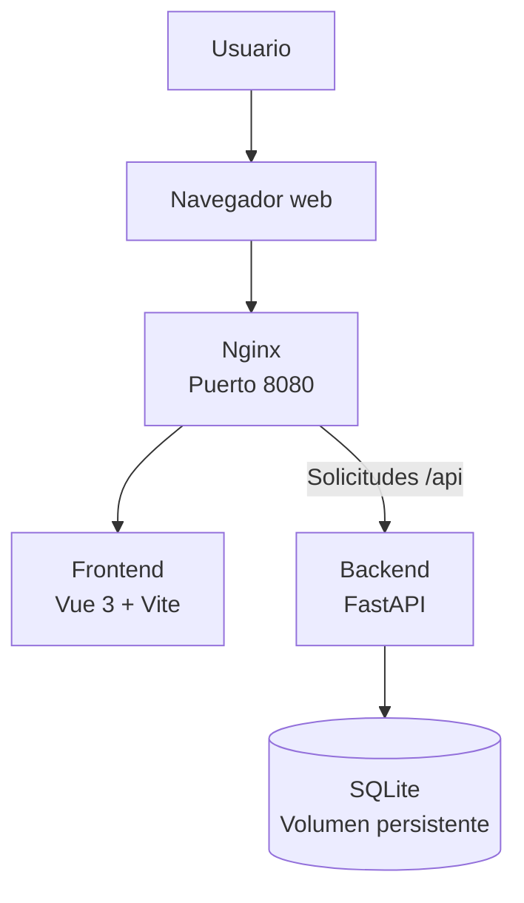
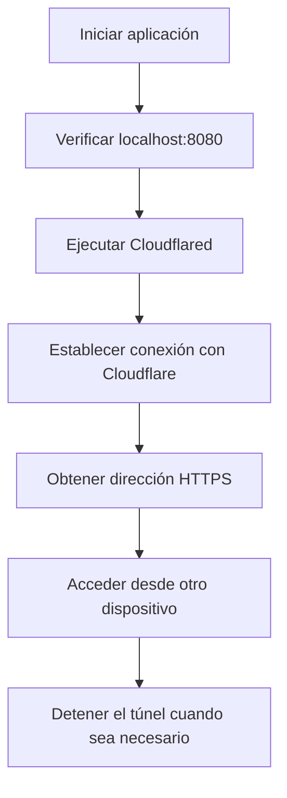

 <div align="center">

# SISTEMA DE CONTRATACIONES

### Plataforma web para la gestión y seguimiento de candidatos

**Administración · Seguridad · Seguimiento · Control de información**


[Repositorio](https://github.com/KevinAlva23/sistema-contrataciones) · [Instalación](#8-instalación-y-puesta-en-marcha) · [Documentación API](#13-documentación-de-la-api) · [Cloudflare Tunnel](#15-publicación-remota-con-cloudflare-tunnel)

</div>

---

## 1. Descripción del proyecto

El **Sistema de Contrataciones** es una aplicación web desarrollada para administrar y dar seguimiento a la información de candidatos dentro de un proceso de contratación.

Su objetivo es centralizar los datos de los aspirantes, facilitar la actualización de sus estados y proporcionar herramientas de consulta, administración y auditoría.

La plataforma incorpora autenticación de usuarios, permisos diferenciados por roles, registro de actividades, estadísticas, exportación de información y mecanismos de respaldo.

El sistema está construido con tecnologías de código abierto y utiliza contenedores para facilitar su instalación y ejecución.

## 2. Objetivo

Desarrollar una herramienta digital que facilite la administración y el seguimiento de candidatos mediante una plataforma centralizada, segura y organizada, que permita mejorar el control de la información y mantener evidencia de las operaciones realizadas.

### Objetivos específicos

- Centralizar la información de los candidatos.
- Registrar y actualizar el estado de cada candidato.
- Administrar usuarios y permisos de acceso.
- Mantener una bitácora de las operaciones realizadas.
- Facilitar la búsqueda, consulta y organización de registros.
- Generar estadísticas y exportar información.
- Implementar mecanismos de respaldo y recuperación de datos.
- Proporcionar acceso local y opciones de publicación remota.

## 3. Funcionalidades del sistema

| Módulo | Descripción |
|---|---|
| Inicio de sesión | Autenticación de usuarios. |
| Gestión de candidatos | Alta, consulta y edición de registros. |
| Seguimiento | Actualización del estado de los candidatos. |
| Búsqueda y filtros | Consulta por nombre, correo, puesto y estado. |
| Tablero | Organización visual de candidatos por estado. |
| Administración de usuarios | Creación, modificación, activación y desactivación de cuentas. |
| Control de roles | Permisos diferenciados para cada tipo de usuario. |
| Bitácora de auditoría | Registro de actividades y operaciones. |
| Estadísticas | Indicadores por estado, puesto y mes. |
| Exportación CSV | Descarga de información de candidatos. |
| Importación CSV | Incorporación de candidatos mediante archivos CSV. |
| Respaldos | Generación, consulta y restauración de copias de seguridad. |
| Accesibilidad | Navegación por teclado, etiquetas accesibles y preferencias visuales. |

### Estados de seguimiento

El sistema contempla los siguientes estados en el proceso de selección:

- Pendiente.
- En entrevista.
- Oferta enviada.
- Contratado.
- Rechazado.

Las opciones disponibles y su comportamiento dependen de la configuración de la aplicación.

## 4. Arquitectura tecnológica

La aplicación utiliza una arquitectura cliente-servidor compuesta por un frontend, un servidor web, una API y una base de datos.

### Diagrama de arquitectura



### Tecnologías utilizadas

| Componente | Tecnología | Función |
|---|---|---|
| Frontend | Vue 3 | Interfaz de usuario. |
| Herramienta frontend | Vite | Desarrollo y compilación. |
| Servidor web | Nginx | Publicación de la interfaz y proxy de API. |
| Backend | Python y FastAPI | Lógica de negocio y servicios. |
| Modelado de datos | SQLModel | Definición y manejo de modelos. |
| Base de datos | SQLite | Almacenamiento persistente. |
| Autenticación | JWT | Gestión de sesiones. |
| Contraseñas | bcrypt | Almacenamiento seguro mediante hash. |
| Contenedores | Podman / Docker | Ejecución de los servicios. |
| Pruebas | pytest | Validación automatizada. |
| Integración continua | GitHub Actions | Ejecución de pruebas y compilación. |
| Acceso remoto | Cloudflare Tunnel | Publicación de la aplicación mediante HTTPS. |

### Funcionamiento de los servicios

- El navegador accede a la aplicación mediante el puerto `8080`.
- Nginx sirve la interfaz web.
- Las solicitudes dirigidas a `/api` se reenvían al backend FastAPI.
- El backend consulta y modifica la información almacenada en SQLite.
- Los servicios se comunican mediante la red interna `red-contrataciones`.
- La base de datos utiliza el volumen persistente `datos`.
- El backend no publica directamente un puerto hacia el exterior.

## 5. Roles y permisos

El sistema cuenta con tres perfiles de acceso.

| Permiso | Administrador | Reclutador | Auditor |
|---|:---:|:---:|:---:|
| Consultar candidatos | Sí | Sí | Sí |
| Agregar candidatos | Sí | Sí | No |
| Editar candidatos | Sí | Sí | No |
| Contratar o rechazar | Sí | Sí | No |
| Eliminar candidatos | Sí | No | No |
| Administrar usuarios | Sí | No | No |
| Consultar bitácora | Sí | No | Sí |
| Exportar CSV | Sí | No | Sí |

Los permisos se validan en el backend y no únicamente en la interfaz.

## 6. Seguridad de la aplicación

El sistema incorpora mecanismos para proteger las cuentas, controlar el acceso y mantener registros de actividad.

### Autenticación y contraseñas

- Autenticación mediante tokens JWT.
- Contraseñas protegidas con bcrypt.
- Longitud mínima de 10 caracteres.
- Requerimiento de mayúsculas, minúsculas y números.
- Cambio de contraseña desde la cuenta del usuario.
- Restablecimiento de contraseñas por parte del administrador.

### Protección de acceso

- Las sesiones caducan después de 8 horas.
- Después de 5 intentos fallidos de inicio de sesión, la cuenta se bloquea durante 10 minutos.
- Los permisos se comprueban en el backend.
- Se registra la actividad relacionada con los accesos y las operaciones del sistema.

### Protección de infraestructura

La configuración de Nginx y los contenedores contempla:

- Content Security Policy (CSP).
- Encabezado X-Frame-Options.
- Protección X-Content-Type-Options.
- Contenedores con restricciones de privilegios.
- Límites de memoria.
- Reinicio automático de los contenedores.

## 7. Accesibilidad y experiencia de usuario

La aplicación contempla características para facilitar su utilización:

- Navegación mediante teclado.
- Enlace para saltar directamente al contenido.
- Indicadores visibles de enfoque.
- Etiquetas para lectores de pantalla.
- Mensajes de error accesibles.
- Diseño adaptable a dispositivos móviles.
- Modo claro y oscuro.
- Preferencia de movimiento reducido.
- Modo compacto.
- Atajos de teclado para acciones frecuentes.

## 8. Instalación y puesta en marcha

### 8.1. Requisitos

- Linux o Windows.
- Git.
- Podman o Docker.
- Podman Compose o Docker Compose.
- Navegador web.
- Conexión a Internet para obtener el repositorio y las dependencias.

### 8.2. Descargar el proyecto

Clonar el repositorio:

```bash
git clone https://github.com/KevinAlva23/sistema-contrataciones.git
```

Entrar al directorio:

```bash
cd sistema-contrataciones
```

### 8.3. Configurar las variables de entorno

Crear el archivo `.env` en la raíz del proyecto:

```bash
nano .env
```

Agregar la configuración inicial:

```env
SECRET_KEY=una-frase-larga-y-aleatoria
ADMIN_USER=admin
ADMIN_PASSWORD=una-clave-segura
```

Descripción:

| Variable | Función |
|---|---|
| `SECRET_KEY` | Clave utilizada para firmar los tokens de sesión. |
| `ADMIN_USER` | Nombre del primer administrador. |
| `ADMIN_PASSWORD` | Contraseña inicial del administrador. |

El usuario administrador inicial se crea únicamente cuando la base de datos todavía no contiene usuarios.

Proteger el archivo:

```bash
chmod 600 .env
```

**Importante:** el archivo `.env` contiene información sensible y no debe publicarse en GitHub. El repositorio lo excluye mediante `.gitignore`.

### 8.4. Iniciar en Linux

Dar permisos de ejecución al script:

```bash
chmod +x iniciar.sh
```

Iniciar la aplicación:

```bash
./iniciar.sh
```

El script construye las imágenes, crea la red y el volumen, inicia el backend, espera a que esté disponible y posteriormente inicia el frontend.

### 8.5. Iniciar mediante Compose

Como alternativa, se puede utilizar:

```bash
podman compose up -d --build
```

O con Docker:

```bash
docker compose up -d --build
```

**Nota:** utilizar el script de inicio o Compose como método de administración, sin ejecutar ambos simultáneamente.

### 8.6. Iniciar en Windows

En Windows se puede utilizar Docker Desktop con Docker Compose.

Desde PowerShell, después de clonar el repositorio y configurar el entorno:

```powershell
docker compose up -d --build
```

El script `iniciar.sh` está diseñado para Bash. Para Windows se recomienda utilizar Compose directamente desde PowerShell.

### 8.7. Acceder al sistema

Una vez que los servicios estén activos, abrir:

| Servicio | Dirección |
|---|---|
| Aplicación web | `http://localhost:8080` |
| Documentación de API | `http://localhost:8080/api/docs` |

### 8.8. Detener la aplicación

En Linux, utilizar:

```bash
./iniciar.sh detener
```

Los datos almacenados en el volumen persistente se conservan al detener los contenedores.

## 9. Administración de candidatos

La plataforma permite administrar los registros de candidatos mediante las siguientes operaciones:

- Registrar nuevos candidatos.
- Consultar información existente.
- Editar datos.
- Cambiar el estado de seguimiento.
- Buscar por nombre, correo electrónico o puesto.
- Filtrar por estado.
- Consultar información en formato de tabla o tarjetas.
- Visualizar estadísticas.
- Organizar candidatos mediante un tablero.
- Importar y exportar información CSV, de acuerdo con los permisos.

### Validaciones

La API realiza validaciones para mantener la consistencia de los datos:

- El teléfono debe contener 10 dígitos.
- El correo electrónico debe ser único.
- Los campos se validan tanto en la interfaz como en el backend.

## 10. Administración de usuarios y auditoría

### Administración de usuarios

El administrador puede:

- Crear usuarios.
- Activar o desactivar cuentas.
- Modificar roles.
- Restablecer contraseñas.
- Eliminar usuarios.
- Mantener la protección para evitar quedarse sin una cuenta administradora.

### Bitácora de auditoría

El sistema registra operaciones relevantes, entre ellas:

- Altas de candidatos.
- Modificaciones de información.
- Cambios de estado.
- Eliminaciones.
- Modificaciones de usuarios.
- Inicios de sesión.
- Intentos de acceso fallidos.

La bitácora puede consultarse mediante los perfiles autorizados de administrador y auditor.

## 11. Base de datos y persistencia

La configuración documentada del proyecto utiliza SQLite.

La base de datos se almacena mediante un volumen persistente denominado `datos`, lo que permite conservar la información aunque los contenedores sean detenidos o eliminados.

La persistencia es importante para evitar que los registros dependan del ciclo de vida de los contenedores.

El historial del proyecto incluye también una etapa de trabajo con PostgreSQL y Alembic en la versión 1.23. Esta referencia corresponde al historial de desarrollo y no debe confundirse con la configuración SQLite documentada para la ejecución actual.

## 12. Respaldos y recuperación

El proyecto incluye el script `respaldo.sh`, que permite crear, consultar y restaurar copias de seguridad de la base de datos.

### Crear un respaldo

```bash
./respaldo.sh
```

### Consultar respaldos disponibles

```bash
./respaldo.sh listar
```

### Restaurar un respaldo

```bash
./respaldo.sh restaurar ARCHIVO
```

Sustituir `ARCHIVO` por el nombre del respaldo que se desea restaurar.

El sistema conserva los últimos 14 respaldos.

La carpeta `respaldos/` no se publica en GitHub, ya que puede contener información personal.

**Recomendación:** verificar periódicamente los respaldos y realizar pruebas de recuperación antes de depender de ellos en un entorno operativo.

## 13. Documentación de la API

El backend utiliza FastAPI para gestionar las operaciones del sistema.

La documentación interactiva se encuentra en:

```text
http://localhost:8080/api/docs
```

### Endpoints principales

| Método | Endpoint | Descripción |
|---|---|---|
| POST | `/login` | Inicio de sesión y generación de token. |
| GET | `/yo` | Consulta del usuario autenticado. |
| POST | `/cambiar-clave` | Cambio de contraseña propia. |
| GET | `/usuarios` | Consulta de usuarios. |
| POST | `/usuarios` | Creación de usuarios. |
| PATCH | `/usuarios` | Modificación de usuarios. |
| DELETE | `/usuarios` | Eliminación de usuarios. |
| GET | `/bitacora` | Consulta de registros de auditoría. |
| GET | `/candidatos` | Consulta de candidatos. |
| POST | `/candidatos` | Registro de candidatos. |
| PUT | `/candidatos/{id}` | Edición de candidatos. |
| PATCH | `/candidatos/{id}?estado=...` | Actualización del estado. |
| DELETE | `/candidatos/{id}` | Eliminación de candidatos. |

Los permisos de cada endpoint se aplican de acuerdo con el rol del usuario autenticado.

## 14. Pruebas y validación

El proyecto utiliza pytest para ejecutar pruebas automatizadas del backend.

Desde la raíz del repositorio:

```bash
cd backend
```

Instalar las dependencias necesarias para las pruebas:

```bash
pip install -r requirements.txt -r requirements-dev.txt
```

Ejecutar las pruebas:

```bash
pytest
```

### Integración continua

GitHub Actions ejecuta procesos automatizados para:

- Ejecutar las pruebas del backend.
- Validar el funcionamiento de componentes.
- Compilar el frontend.

El flujo de trabajo se encuentra en:

```text
.github/workflows/tests.yml
```

## 15. Publicación remota con Cloudflare Tunnel

El sistema puede utilizarse localmente o publicarse de manera remota mediante **Cloudflare Tunnel**.

Esta herramienta permite establecer una conexión entre el servicio local y una dirección pública HTTPS, sin necesidad de abrir puertos en el router.

Para este proyecto, la aplicación se publica utilizando el puerto `8080`.

### 15.1. Instalar Cloudflared sin permisos de administrador

En Linux de arquitectura AMD64, se puede instalar el ejecutable en el directorio personal del usuario.

Crear el directorio:

```bash
mkdir -p ~/.local/bin
```

Descargar Cloudflared:

```bash
curl -L -C - --retry 10 \
-o ~/.local/bin/cloudflared \
https://github.com/cloudflare/cloudflared/releases/latest/download/cloudflared-linux-amd64
```

Dar permisos de ejecución:

```bash
chmod +x ~/.local/bin/cloudflared
```

Comprobar la instalación:

```bash
~/.local/bin/cloudflared --version
```

### 15.2. Verificar que la aplicación esté funcionando

Iniciar el Sistema de Contrataciones:

```bash
./iniciar.sh
```

Comprobar la respuesta del servidor:

```bash
curl -I http://localhost:8080
```

La aplicación debe responder correctamente antes de abrir el túnel.

### 15.3. Abrir el túnel en primer plano

Ejecutar:

```bash
~/.local/bin/cloudflared tunnel --url http://localhost:8080
```

Cloudflared establecerá la conexión y mostrará una dirección similar a:

```text
https://nombre-generado.trycloudflare.com
```

La dirección exacta será la que aparezca en la terminal.

Copiar esa dirección y abrirla desde otro dispositivo con conexión a Internet.

**Mientras la terminal permanezca ejecutando Cloudflared, el túnel seguirá activo.**

### 15.4. Ejecutar el túnel en segundo plano

Si se desea mantener el túnel funcionando sin ocupar una terminal, ejecutar:

```bash
nohup ~/.local/bin/cloudflared tunnel \
--url http://localhost:8080 \
> ~/tunel.log 2>&1 &
```

Este comando inicia Cloudflared en segundo plano y guarda su salida en `tunel.log`.

### 15.5. Consultar la dirección pública

Para obtener la dirección generada:

```bash
grep -o "https://[a-z0-9-]*\.trycloudflare\.com" ~/tunel.log | head -1
```

El resultado mostrará la dirección pública asignada al túnel.

También se puede consultar el registro completo:

```bash
cat ~/tunel.log
```

### 15.6. Comprobar que el túnel esté activo

Consultar el proceso:

```bash
pgrep -a cloudflared
```

Si aparece un proceso de Cloudflared, significa que el programa continúa ejecutándose.

### 15.7. Cerrar el túnel

Para detener Cloudflared:

```bash
pkill cloudflared
```

También se puede presionar `Ctrl + C` cuando se ejecuta en primer plano.

Al detener el túnel, la dirección pública deja de estar disponible, aunque la aplicación puede continuar funcionando localmente.

### 15.8. Consideraciones de publicación

- La dirección `trycloudflare.com` es temporal.
- La dirección puede cambiar cuando se crea un nuevo túnel.
- El equipo debe permanecer encendido y conectado a Internet.
- La aplicación debe continuar activa en el puerto 8080.
- El túnel proporciona conectividad HTTPS, pero no reemplaza los controles de seguridad de la aplicación.
- No se debe publicar información confidencial en un entorno de demostración.
- Para disponer de una dirección permanente se requiere configurar un túnel administrado y un dominio.

### Flujo de publicación



## 16. Comandos de administración

Los siguientes comandos facilitan la supervisión de los servicios cuando se utiliza Podman.

### Consultar contenedores

```bash
podman ps
```

### Consultar registros del backend

```bash
podman logs -f backend
```

### Consultar registros del frontend

```bash
podman logs -f frontend
```

### Consultar la respuesta local

```bash
curl -I http://localhost:8080
```

Estos comandos permiten revisar el estado de los servicios y detectar posibles errores durante la ejecución.

## 17. Estructura del repositorio

```text
sistema-contrataciones/
│
├── backend/
│   ├── main.py
│   ├── requirements.txt
│   ├── requirements-dev.txt
│   ├── Dockerfile
│   └── tests/
│
├── frontend/
│   ├── src/
│   ├── nginx.conf
│   └── Dockerfile
│
├── .github/
│   └── workflows/
│       └── tests.yml
│
├── .env.demo
├── .gitignore
├── docker-compose.yml
├── iniciar.sh
├── demo.sh
├── respaldo.sh
└── README.md
```

### Archivos principales

| Archivo | Función |
|---|---|
| `backend/main.py` | Aplicación y endpoints de FastAPI. |
| `frontend/` | Interfaz web desarrollada con Vue. |
| `frontend/nginx.conf` | Configuración del servidor web y proxy. |
| `docker-compose.yml` | Definición de servicios y contenedores. |
| `iniciar.sh` | Construcción, inicio y detención del sistema. |
| `demo.sh` | Script de entorno de demostración. |
| `respaldo.sh` | Creación, consulta y restauración de respaldos. |
| `.env.demo` | Configuración de demostración. |
| `.gitignore` | Exclusión de archivos locales y sensibles. |

## 18. Historial de versiones

| Versión | Actualizaciones |
|---|---|
| **v1.27 – Comodidad y datos** | Tema claro/oscuro manual, modo compacto, aviso de caducidad de sesión e importación CSV con reporte de errores. |
| **v1.26 – Detalle y atajos** | Panel lateral de detalle y atajos de teclado. |
| **v1.25 – Tablero** | Vista de tablero por estado con arrastrar y soltar; selector accesible para cambiar candidatos de estado. |
| **v1.24 – Pulido visual** | Avisos flotantes, avatares con iniciales y vistas de tabla o tarjetas. |
| **v1.23 – PostgreSQL y Alembic** | Incorporación de PostgreSQL, migraciones con Alembic y respaldos mediante pg_dump. |
| **v1.22 – Embudo y seguimiento** | Embudo de selección, alertas de candidatos sin avances y días desde el registro. |
| **v1.21 – Estados y notas** | Estados de entrevista y oferta enviada, notas de seguimiento y estadísticas. |
| **v1.20 – Publicación del sistema** | Documentación de Cloudflare Tunnel, ejecución en segundo plano y recomendaciones de seguridad. |
| **v1.19 – Orden y paginación** | Ordenamiento de registros, paginación y mejoras de accesibilidad. |
| **v1.18 – Accesibilidad y modo oscuro** | Navegación por teclado, modo oscuro automático, etiquetas accesibles y movimiento reducido. |
| **v1.17 – Endurecimiento** | Encabezados de seguridad en Nginx, restricciones de contenedores y límites de memoria. |
| **v1.16 – Estadísticas** | Indicadores generales, estadísticas por estado, puesto y mes. |
| **v1.15 – Exportación** | Exportación CSV, neutralización de fórmulas y registro de exportaciones. |
| **v1.14 – Contraseñas** | Cambio de contraseña, política de seguridad y registro en bitácora. |
| **v1.13 – Pruebas automáticas** | Pruebas con pytest, GitHub Actions y configuración de la ruta de base de datos. |
| **v1.12 – Respaldos** | Copias de seguridad con fecha, conservación de 14 respaldos y restauración. |
| **v1.11 – Bitácora de auditoría** | Registro de operaciones, accesos y actividades de usuarios. |
| **v1.10 – Administración de usuarios** | Creación, activación, desactivación, cambio de roles y restablecimiento de contraseñas. |
| **v1.9 – Seguridad de acceso** | Bloqueo temporal después de intentos fallidos de inicio de sesión. |
| **v1.8 – Rediseño** | Barra superior, tarjetas de resumen, paneles y diseño adaptable. |
| **v1.7 – Usuarios y roles** | Autenticación con bcrypt y JWT, roles y configuración de secretos. |
| **v1.6 – Script de inicio** | Automatización del inicio de los servicios. |
| **v1.5 – Validaciones en backend** | Validación de teléfono y correo electrónico en la API. |
| **v1.4 – Búsqueda y confirmación** | Buscador y confirmación antes de eliminar registros. |
| **v1.3 – Contenedores por separado** | Separación de frontend y backend, red interna y volumen persistente. |
| **v1.2 – Edición de candidatos** | Incorporación de la edición de registros. |
| **v1.1 – Filtro y diseño** | Filtro por estado y mejoras visuales. |
| **v1.0 – Primera versión** | Registro, cambio de estado y eliminación de candidatos. |

---

## 19. Consideraciones operativas

Para mantener el funcionamiento adecuado de la plataforma se recomienda:

1. Mantener protegidas las credenciales y variables de entorno.
2. Utilizar contraseñas seguras.
3. Revisar periódicamente los usuarios y sus permisos.
4. Consultar la bitácora de auditoría.
5. Realizar respaldos periódicos.
6. Verificar el estado de los contenedores.
7. Mantener actualizadas las dependencias.
8. Probar los procedimientos de recuperación.
9. Evitar exponer información personal en entornos públicos.
10. Validar los cambios antes de incorporar nuevas versiones.

**Uso de información:** para pruebas y demostraciones se recomienda utilizar datos ficticios. Cualquier uso con información real debe contar con la autorización correspondiente y cumplir las políticas de seguridad y protección de datos aplicables.

## 20. Información del proyecto

| Campo | Información |
|---|---|
| **Nombre** | Sistema de Contrataciones |
| **Desarrollador** | Kevin Alvarado Garduño |
| **Versión documentada** | 1.27 |
| **Repositorio** | GitHub |
| **Tecnologías principales** | Vue 3, FastAPI, Nginx, SQLite y Podman |
| **Tipo de aplicación** | Aplicación web de gestión |


<div align="center">

# SISTEMA DE CONTRATACIONES

**Gestión eficiente · Información organizada · Control y seguimiento**

*Proyecto de desarrollo de software.*

**Kevin Alvarado Garduño**

</div>
